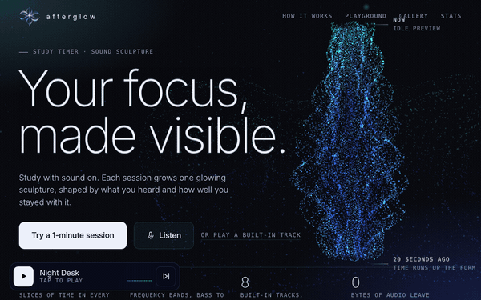

# Afterglow



A study timer that grows a glowing 3D particle sculpture from sound. One session, one sculpture.

- Time runs up the form, frequencies shape each slice, colour shifts when the track changes.
- Leaving the tab (10 s grace) or going idle scatters particles and leaves a notch at that height.
- Eight built-in generated tracks (Web Audio, no samples) including two 40 Hz tracks, microphone input, or your own audio file.
- Team rooms with no server: a room code carries the start time so everyone runs the same timer, then you swap result codes for a team board.
- Custom session and break lengths, subject tags, focus score 0-100, check-ins every 25 minutes, pause, break mode with a breathing guide.
- A session you end early is saved unfinished, exactly as far as it grew.
- 10-second growth replay, share-card image, local gallery, weekly stats, 3D sculpture garden, exam countdown.
- A reload or crash mid-session picks up where it stopped. Back up and restore your gallery as a file.
- Installable and usable offline once deployed (`manifest.webmanifest` + `sw.js`).
- Sound sources also include another browser tab's audio (desktop Chrome and Edge), so music from a streaming tab works with headphones on.
- No accounts, no analytics, no network calls. Everything stays in `localStorage` on the device.

## Run it

It is a static site with no build step and no dependencies.

```
npx serve .        # or: python3 -m http.server
```

Open the printed URL. The mic and the floating window need `https://` or `localhost`.

## Deploy to Vercel

1. Push this folder to a GitHub repository.
2. In Vercel: Add New > Project > import the repository.
3. Framework preset: **Other**. Leave build command and output directory empty.
4. Deploy.

## Files

| File | What it does |
| --- | --- |
| `index.html` | Markup for every section |
| `styles.css` | Design tokens and layout |
| `js/gl.js` | WebGL particle engine, shapes, scroll morphing, adaptive quality |
| `js/audio.js` | Generated tracks, mic, file upload, 16-band analysis |
| `js/app.js` | Sessions, distraction detection, team rooms, gallery, stats, garden, share card, UI |
| `sw.js`, `manifest.webmanifest`, `icons/` | Offline support and install-as-app |
| `logo.png` | The Afterglow mark used in the header |
| `og.png` | Link preview image |
| `docs/demo.gif` | The GIF at the top of this README |

## Browser support

| Feature | Works in |
| --- | --- |
| Sculpture, tracks, sessions, gallery, stats | Any current browser with WebGL and Web Audio |
| Microphone | Any current browser over HTTPS, after you allow it |
| Floating always-on-top timer (Document Picture-in-Picture) | Chrome and Edge on desktop. Elsewhere it falls back to a popup, then to a docked timer plus the tab title |
| System-wide idle detection in "Somewhere else" mode | Chrome and Edge on desktop, after you allow it. Elsewhere only check-ins count |
| Check-in notifications | Browsers with the Notifications API, after you allow them |
| Another tab's audio | Chrome and Edge on desktop. Pick a tab and tick "Also share tab audio" |
| Keep the screen awake | Browsers with the Screen Wake Lock API |
| Share sheet for the card image | Mostly phones. Everywhere else use Save image |

## What it cannot know

Afterglow sees only whether its own tab is in front and whether you are moving in it. It cannot see other tabs, other apps or your phone. The focus score is a mirror, not a monitor.

Spotify and YouTube audio cannot be analysed by a web page, so they are not supported. Use the mic to pick up whatever is playing in the room instead.

## After you deploy

1. **Link preview.** LinkedIn and most chat apps need a full address for the preview image. In `index.html`, change `content="og.png"` to `content="https://YOUR-SITE.vercel.app/og.png"`.
2. **Updates.** When you change files later, bump `VERSION` at the top of `sw.js` so returning visitors get the new version.
3. **Fonts.** The two typefaces load from Google Fonts and are cached for offline use after the first visit. To make zero outside requests, download Bricolage Grotesque and DM Mono as `.woff2`, put them in a `fonts/` folder, and replace the Google Fonts `<link>` with `@font-face` rules.
4. **Demo GIF.** `docs/demo.gif` was captured with software rendering at reduced particle count. A screen recording from your own machine will look better.
